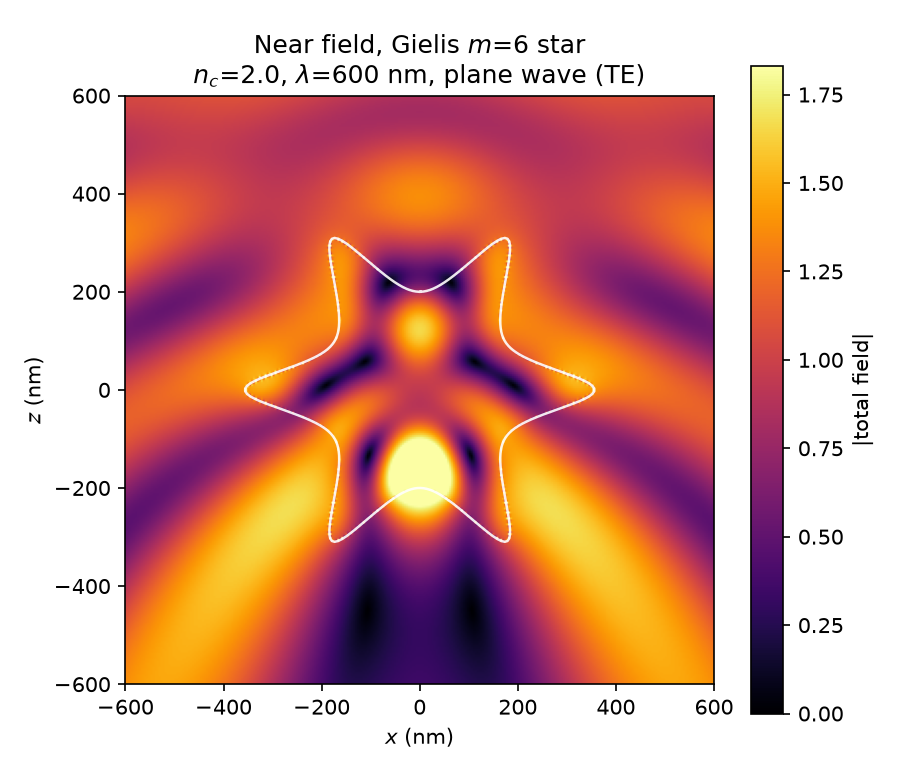
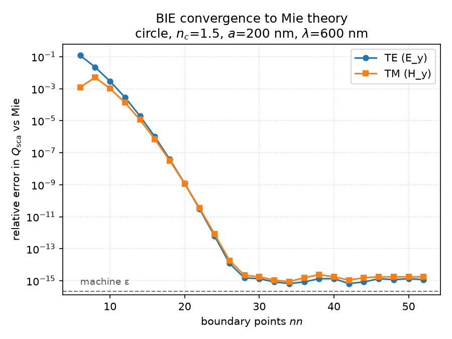

# pysie2d

[](https://github.com/claudio-sc/pysie2d/actions/workflows/ci.yml)
[](https://pypi.org/project/pysie2d/)
[](https://github.com/claudio-sc/pysie2d/blob/main/LICENSE)
[](https://www.python.org/downloads/)

A 2-D surface-integral-equation solver for time-harmonic electromagnetic
scattering by smooth cylinders, circular or Gielis-superformula in
cross-section, at real or complex wavelength. Single particles and finite
clusters, in a homogeneous background, over a half-space, or over a layered
stack. Convergence is spectral, each feature is checked against a reference
independent of the solver wherever one exists, and the public API is typed.



## Install

```bash
pip install pysie2d
```

From a clone, with [uv](https://docs.astral.sh/uv/) and Python 3.12+:

```bash
uv sync                       # create the environment
uv run pytest                 # run the validation suite
uv run ruff format --check . && uv run ruff check .
```

## Minimal use

```python
from pysie2d import BIESolver, Geometry, Material

geom = Geometry.gielis(rad=200, n_pts=300, m=0)  # circular cylinder, nm
mat = Material(n_core=1.5, n_clad=1.0, pol=2)  # TE
result = BIESolver(geom, mat).scatter(wavelength=600.0)  # vacuum nm
print(result.efficiencies())  # {'qsca', 'qext', 'qabs'}
```

The snippets here and in the feature guides are excerpts of scripts in
[`examples/`](https://github.com/claudio-sc/pysie2d/tree/main/examples). CI runs
every one of them, with the numbers they state asserted.

## What it does

| Capability | Entry point | Guide |
|---|---|---|
| Plane waves and line dipoles, near and far field, cross-sections | `BIESolver`, `ScatterResult` | [scattering](https://github.com/claudio-sc/pysie2d/blob/main/docs/scattering.md) |
| Relative LDOS and Purcell maps | `relative_ldos`, `relative_ldos_map` | [scattering](https://github.com/claudio-sc/pysie2d/blob/main/docs/scattering.md) |
| Multipole decomposition | `ScatterResult.multipoles` | [scattering](https://github.com/claudio-sc/pysie2d/blob/main/docs/scattering.md#multipole-decomposition) |
| Quasi-normal modes by Beyn's contour method | `QNMSolver`, `QNMResult` | [QNM guide](https://github.com/claudio-sc/pysie2d/blob/main/docs/qnm-guide.md) |
| Elliptic, adaptive and interpolated contours | `QNMSolver.modes(contour=, adaptive=, interpolate=)` | [QNM guide](https://github.com/claudio-sc/pysie2d/blob/main/docs/qnm-guide.md#letting-the-contour-choose-its-node-count) |
| Adjoint mode sensitivity `dλ/dp` | `QNMResult.sensitivity` | [mode sensitivity](https://github.com/claudio-sc/pysie2d/blob/main/docs/mode-sensitivity.md) |
| Finite clusters of particles | `Cluster`, `ClusterBIESolver` | [clusters](https://github.com/claudio-sc/pysie2d/blob/main/docs/clusters.md) |
| Many materials at one wavelength, eigenpermittivities | `ClusterBIESolver.at_wavelength`, `ClusterEigenEps` | [clusters](https://github.com/claudio-sc/pysie2d/blob/main/docs/clusters.md#many-materials-at-one-wavelength) |
| Half-space substrate, fields above and below it | `HalfSpace` | [layered backgrounds](https://github.com/claudio-sc/pysie2d/blob/main/docs/layered-backgrounds.md) |
| N-layer stack, guided modes, scattering-matrix columns | `Stack`, `mode_amplitudes` | [layered backgrounds](https://github.com/claudio-sc/pysie2d/blob/main/docs/layered-backgrounds.md#a-layered-stack-and-its-guided-modes) |

Lengths are in nm, wavelengths are vacuum wavelengths, and the time convention
is `exp(-iωt)`. Every sign and layout convention is in
[docs/conventions.md](https://github.com/claudio-sc/pysie2d/blob/main/docs/conventions.md).

## Validation

Each feature is checked against something that shares none of its assumptions:
analytic Mie theory and its poles for a circle, a closed-form self-Green
function, a two-cylinder addition-theorem solution for clusters, image and
closed-form solutions over a perfect conductor, and real-axis quadrature
references for the layered Green functions. Without a closed form, as for a
Gielis star, the reference is two independent solvers: MEEP (FDTD) and
FEniCSx/dolfinx (FEM). Their results are committed to `tests/data/` with full
provenance, so `uv run pytest` re-checks them with numpy alone. Every tolerance
is derived from a measurement.

[docs/validation.md](https://github.com/claudio-sc/pysie2d/blob/main/docs/validation.md)
gives the whole account in one page, including what is **not** validated.



## Documentation

- [Scattering, fields and the LDOS](https://github.com/claudio-sc/pysie2d/blob/main/docs/scattering.md), with the formulation, the references and performance
- [Finding quasi-normal modes](https://github.com/claudio-sc/pysie2d/blob/main/docs/qnm-guide.md) and [mode sensitivity](https://github.com/claudio-sc/pysie2d/blob/main/docs/mode-sensitivity.md)
- [Clusters of particles](https://github.com/claudio-sc/pysie2d/blob/main/docs/clusters.md)
- [Layered backgrounds](https://github.com/claudio-sc/pysie2d/blob/main/docs/layered-backgrounds.md)
- [Conventions](https://github.com/claudio-sc/pysie2d/blob/main/docs/conventions.md) and [validation](https://github.com/claudio-sc/pysie2d/blob/main/docs/validation.md)
- [Migrating from v0.5 to v0.6](https://github.com/claudio-sc/pysie2d/blob/main/docs/migrating-to-v0.6.md)
- Release history: [CHANGELOG.md](https://github.com/claudio-sc/pysie2d/blob/main/CHANGELOG.md)

## Citing

Citation metadata live in [CITATION.cff](https://github.com/claudio-sc/pysie2d/blob/main/CITATION.cff); GitHub's *Cite this
repository* button turns them into BibTeX or APA. Releases are archived on
Zenodo, which gives each version its own DOI.

## License

MIT; see [LICENSE](https://github.com/claudio-sc/pysie2d/blob/main/LICENSE).
