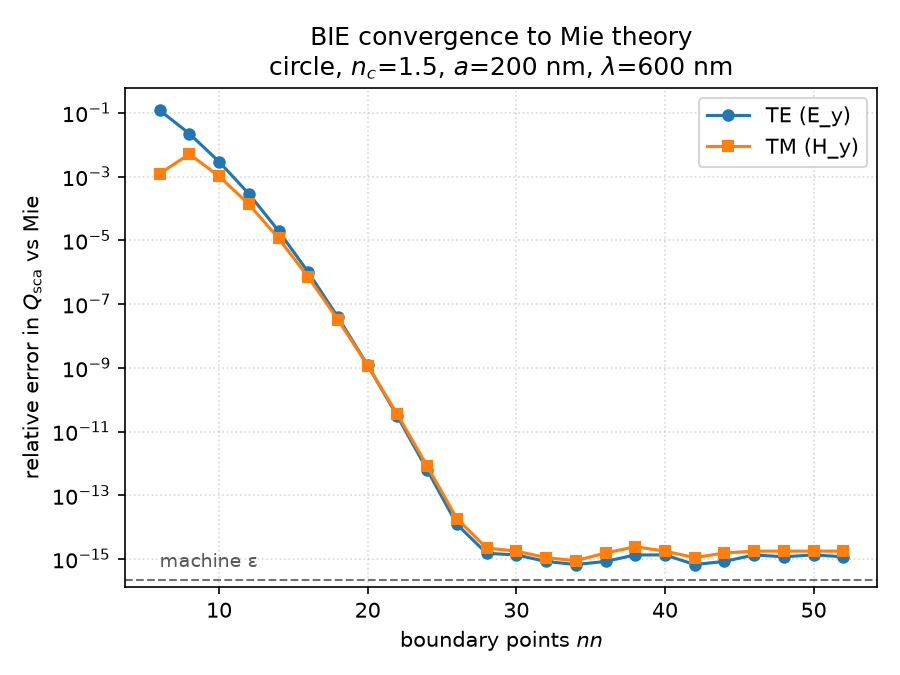
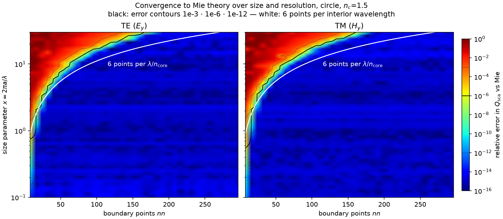
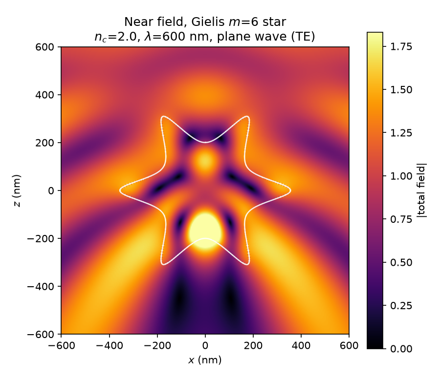
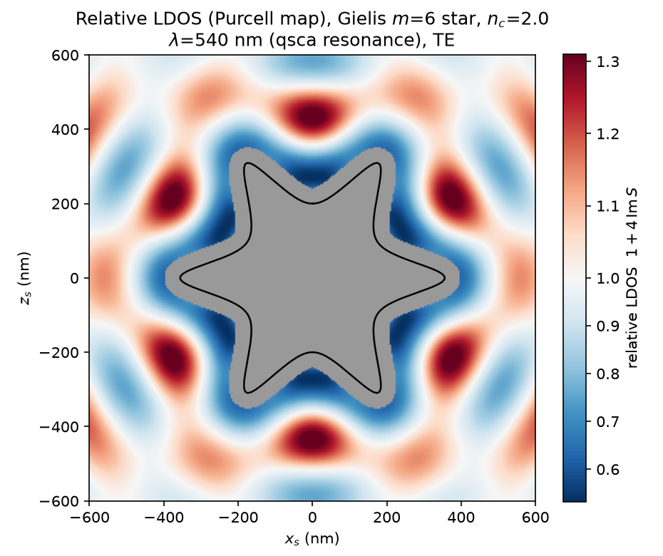

# Scattering, fields and the LDOS

The single-particle solver: plane waves and line dipoles on one smooth cylinder
in a homogeneous background, the near and far field, cross-sections, the
relative LDOS, and the multipole decomposition. Clusters and layered
backgrounds build on it and have their own pages, [clusters.md](clusters.md)
and [layered-backgrounds.md](layered-backgrounds.md).

## Formulation

- The cylinder is invariant along its axis, so Maxwell reduces to a scalar
  Helmholtz problem for one field component (`E_y` for TE, `H_y` for TM).
- The field is given **everywhere** in terms of the surface field and its
  normal derivative; matching across the interface gives a Fredholm integral
  equation of the second kind.
- Discretising the boundary with `nn` nodes yields a dense `2nn × 2nn` complex
  system `M(λ)·ei = rhs`, solved directly.
- The logarithmic singularity of the Green function is integrated exactly by
  Kress–Martensen product quadrature, with nodes placed by a smooth
  `Parametrisation` map, so convergence in `nn` is **spectral**
  ([conventions](conventions.md) §13). Complex wavenumbers are supported
  throughout.
- Lengths are in nm, the time convention is `exp(-iωt)`, and outgoing waves are
  `H_n^{(1)}`.
- **Wavelengths are vacuum wavelengths.** `Material.n_core`, `Material.n_clad`
  and `Material.epsi` are absolute; the background index enters through the
  single conversion `Material.wnum_bg(λ_vac) = 2π·n_clad/λ_vac`, and the
  operator sees only background-relative quantities (`Material.nc`,
  `Material.eps`). The Mie size parameter `x = 2π·n_clad·rad/λ_vac` is exposed
  as the derived `pysie2d.size_parameter` (circular geometry only).

Every sign and layout convention is in [conventions.md](conventions.md). The
analytic reference is Bohren & Huffman, *Absorption and Scattering of Light by
Small Particles*, ch. 8. The boundary-integral approach follows Maradudin,
Michel, McGurn & Méndez, *Enhanced backscattering of light from a random
grating*, Ann. Phys. **203** (1990) 255–307, developed there for randomly rough
surfaces; this implementation uses the closed-surface (particle) form given in
[Valencia *et al.*](https://doi.org/10.1364/JOSAB.20.002150).

## Plane waves and line dipoles

From [`examples/scatter_basic.py`](../examples/scatter_basic.py), which also
checks the circle against Mie theory:

```python
from pysie2d import BIESolver, Geometry, Material, relative_ldos

geom = Geometry.gielis(rad=200, n_pts=300, m=0)  # circular cylinder, nm
mat = Material(n_core=1.5, n_clad=1.0, pol=2)  # TE
result = BIESolver(geom, mat).scatter(wavelength=600.0)  # vacuum nm
print(result.efficiencies())  # {'qsca', 'qext', 'qabs'}

star = Geometry.gielis(rad=200, n_pts=300, m=6, n1=6, n2=12, n3=12)
solver = BIESolver(star, Material(n_core=2.0))
print(relative_ldos(solver, wavelength=540.0, x_s=430.0, z_s=0.0))
```

The LDOS is relative to the unbounded background, `1 + 4·Im S` with `S` the
self-Green function of the scattered field ([conventions](conventions.md) §7).
These are 2-D line-source quantities: absolute values are not 3-D numbers, while
ratios, detunings and `Q` carry over.

## Figures

Relative error of `Q_sca` against Mie theory versus the number of boundary
nodes, both polarisations. Convergence is spectral, a straight line on this
semi-log axis, down to round-off:



The same error over size parameter `x = 0.1 … 30` and `nn`, log colour scale.
The error falls from `10⁻³` to `10⁻¹²` across a narrow front (black contours,
`10⁻⁶` solid); past it the solver is at round-off. The white line is 6 points
per interior wavelength `λ/n_core`, which tracks the front's round-off edge
from `x ≈ 2` up; `10⁻⁶` itself is reached at a median of 4.7:



Near field of a Gielis `m = 6` star under plane-wave illumination (scattered
field outside the boundary, internal field inside):



Relative LDOS around the same star at one of its `qsca` resonances: a line
dipole in a red lobe decays faster than in free space (`1 + 4·Im S > 1`), while
blue regions suppress it. The six-fold pattern mirrors the particle's symmetry.



Regenerate them with:

```bash
uv run python examples/convergence_study.py
uv run python examples/convergence_map.py
uv run python examples/nearfield_map.py
uv run python examples/purcell_map.py
```

## Multipole decomposition

Outside the circumscribing circle of the particle the scattered field is a sum
of outgoing cylindrical harmonics about the particle centre,

```text
ψ_sc(r, θ) = Σ_m c_m · i^m · H_m^(1)(k_bg·r) · e^{imθ}
```

with `θ` measured from `+z` toward `+x`, as everywhere else in this package.
From [`examples/multipoles.py`](../examples/multipoles.py):

```python
res = BIESolver(geom, mat).scatter(wavelength=600.0, angle=30.0)
mp = res.multipoles(mmax=8)

mp.c  # signed orders m = −mmax … mmax
mp.c_plus  # symmetric c_m + c_{−m}  (c_0⁺ = c_0)
mp.c_minus  # antisymmetric c_m − c_{−m}
mp.reconstruct(r0, theta)  # the field back, on any larger circle
```

For `pol = 1` (TM) the symmetric coefficients read as magnetic dipole (`m = 0`),
electric dipole (`m = 1`) and electric quadrupole (`m = 2`). On a circle the
coefficients are the analytic Mie cylinder coefficients exactly,
`c_m = −(−1)^m·χ_m·e^{imα}` with `χ = b_n` for TE and `a_n` for TM, and the
tests hold both polarisations to `3·10⁻¹⁵` at normal and oblique incidence and
at complex wavelength.

The defaults are the substance: the evaluation circle sits at **3 × the
circumscribing radius** (which is *not* `Geometry.rad`: on a rounded square the
circumscribing radius is 2.29 × `rad`), and the angular grid is sized from both
`mmax` and `|k_bg·r0|`. Evaluating inside the circumscribing circle is rejected,
an angular grid too coarse to separate the retained orders is rejected, and an
under-resolved angular spectrum raises `RuntimeWarning` through the
`spectrum_tail` diagnostic on the result. Each guard stands in front of a
measured silent failure; the first is 58 % error at 0.9 × the circumscribing
radius.

What it does not give you: the expansion says nothing about the field *between*
the circumscribing circle and the boundary, the coefficients are referred to the
particle centre and no translation theorem is implemented, and the only
closed-form anchor is Mie on a circle. On a non-circular shape the available
check is self-consistency between two circles, which validates the expansion
against the solver's own field and not the field itself.

## Performance

The system is a dense `2nn × 2nn` complex matrix; at `nn = 300` (a `600 × 600`
solve) one wavelength takes under a second on a modern computer, so wavelength
sweeps are cheap serial `for` loops.

Matrix assembly dominates a single solve, and almost all of that cost is Hankel
evaluation. For real arguments `H_n^{(1)} = J_n + i·Y_n` exactly, and the Cephes
`J_n`/`Y_n` kernels are an order of magnitude faster than the general
complex-argument algorithm, so `hank0`/`hank1`/`cbesh` dispatch on the argument
at runtime: `assemble_matrix` is about 5× faster for a non-absorbing particle
and 1.8× for an absorbing one. Complex wavenumbers take the original path and
are bit-identical, which is what keeps quasi-normal-mode work possible.

For an LDOS map every grid point is a different source, hence a different
right-hand side, but `M(λ)` is the same for all of them. `relative_ldos_map`
factorises `M` **once** with `scipy.linalg.lu_factor` and batches the reuse: one
multi-RHS BLAS-3 `lu_solve` and one vectorised representation-formula evaluation
per chunk rather than a per-point loop (7.5× per source point).

Measured timings for every path are in
[design/performance.md](design/performance.md).
